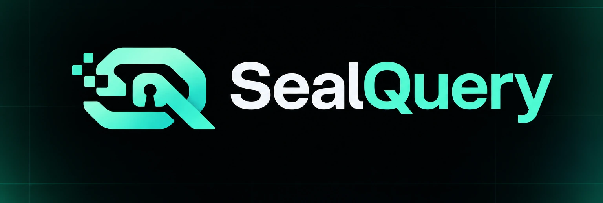

<p align="center">
  
</p>

<h1 align="center">SealQuery</h1>

<p align="center"><strong>Sell the answer, not the dataset.</strong></p>

<p align="center">
  <a href="https://sealquery-web.onrender.com"></a>
  <a href="https://github.com/Sektorial12/SealQuery/actions/workflows/ci.yml"></a>
  
  
  
</p>

<p align="center"><sub>Built at NEAR HACKATHON · testnet prototype</sub></p>

**Live demo:** https://sealquery-web.onrender.com<br />
**Contract:** `contract.sealquery-v2-1794194344.testnet` (v0.2.3)<br />
**API:** https://sealquery-api.onrender.com (v0.6.2)
**Docs:** [architecture](docs/architecture.md) · [evidence](docs/evidence.md) · [operations](docs/operations.md) · [threat model](docs/threat-model.md)

SealQuery lets AI agents pay to execute approved computations against privately held datasets without receiving the raw data. A data owner registers a dataset and the computations it permits. An agent requests one approved computation and pays for execution. The computation runs inside a trusted execution environment. The agent receives an attested result; the data owner receives payment. The raw data is never delivered to the agent.

## Try it in 60 seconds

1. Open the [live app](https://sealquery-web.onrender.com/app) and click **Run query**.
2. Watch the job move from queued to settled; open the result and the attestation card.
3. Click **Test rejected query** to see the workload refuse the request and refund the agent.

No wallet is needed. This is a testnet prototype.

## Contents

- [The problem](#the-problem)
- [What was built](#what-was-built)
- [How NEAR is used](#how-near-is-used)
- [Repository layout](#repository-layout)
- [Requirements](#requirements)
- [Quick start](#quick-start)
- [Web app](#web-app)
- [API](#api)
- [MCP](#mcp)
- [Operations](#operations)
- [Registry and controls](#registry-and-controls)
- [Payment flow](#payment-flow)
- [Privacy controls](#privacy-controls)
- [Test evidence](#test-evidence)
- [Known limitations](#known-limitations)

## The problem

AI agents need external data, but the most valuable datasets cannot be handed over. Selling raw rows exposes sensitive information, violates contracts, or destroys the value of the data. Existing APIs expose only predefined aggregates, and enterprise clean rooms are not built for autonomous per-query agent access.

SealQuery sells the answer, not the dataset. The data owner keeps the raw data; the agent gets an attested result and a receipt.

## What was built

A working NEAR testnet proof with no mocked execution, attestation, access control, or payment:

- A deterministic dataset stored in OutLayer encrypted worker storage (public UCI source used as a private-data stand-in).
- One approved computation running in Intel TDX on OutLayer testnet.
- A dataset-registry NEAR contract (v2) that escrows payment, calls OutLayer, receives the result, and settles to the dataset owner. Registration is contract-owner gated; `register_dataset_for` and `transfer_dataset_owner` let the contract owner onboard a distinct owner.
- An agent client that quotes, pays, waits, verifies the TEE attestation, and accepts the result.
- A per-dataset privacy budget (20 by default), minimum cohort of 100, output rounding, and a canary row that never appears in results.
- Dataset-scoped controls: versions and rotation, pause, per-dataset pricing/budgets, protocol fees, and query history.
- 29 contract tests cover budget exhaustion, pause, unauthorized acceptance, replay, duplicate computations, economics, late callbacks, ready-result refund rejection, owner settlement after timeout, owner onboarding/transfer, and failed/pending refunds.
- Manual negative-path evidence covers unauthorized computations, direct OutLayer calls, and tampered attestations.
- A Next.js product app, FastAPI/Postgres/Redis API, async query worker, refund reconciler, event indexer, owner earnings, readiness/metrics, and Docker Compose + Render deployment.
- Reproducible contract build, CI, deploy scripts, and clean-clone verification with a real query.

## How NEAR is used

- **Dataset registry:** dataset metadata and approved computation list.
- **Query escrow:** the agent’s payment is held by the contract.
- **Execution request:** the contract calls `outlayer.testnet::request_execution`.
- **Callback:** OutLayer resumes the NEAR yield and the contract receives the TEE result.
- **Settlement:** the agent verifies the attestation and calls `accept_result`; the contract pays the data owner.
- **Refunds:** failed or pending timed-out queries are refunded to the agent. Ready queries can be settled to the owner after timeout.
- **Privacy budget:** enforced by the contract before the OutLayer call.

OutLayer provides Intel TDX execution and per-execution attestations. NEAR provides the ownership, escrow, callback, and settlement layer.

## Repository layout

| Path | Purpose |
|---|---|
| `contracts/sealquery/` | NEAR registry, escrow, callback, settlement, and refunds |
| `workload/` | Approved WASI computation and probe workload |
| `agent/` | Agent client: quote, pay, verify, accept/refund |
| `backend/` | FastAPI service, async worker, refund reconciler, event indexer, PostgreSQL models |
| `frontend/` | Next.js product app |
| `mcp/` | MCP stdio server |
| `scripts/` | Dataset, deploy, verification, monitoring, and demo tools |
| `docs/` | Architecture, evidence, operations, threat model, and brand assets |
| `.github/` | CI, issue templates, and PR template |
| `compose.yaml` | Canonical self-host stack with Caddy, Postgres, and Redis |
| `render.yaml` | Hosted Render mirror using Neon and Upstash |

## Requirements

- Python 3.11+
- Docker Engine 24+ and Docker Compose v2 (for `compose.yaml`)
- Node.js 20+ and pnpm 10+ for `frontend/`
- `curl` and `jq` for the operational scripts
- Rust 1.99.1 (pinned in `rust-toolchain.toml`)
- `cargo-near` 0.23.0
- `near-cli-rs` 0.31.1
- `wasmtime` 50.0.1
- `outlayer` CLI 0.2.2
- `outlayer-verify` 0.1.0
- Python packages: `backend/requirements.txt`
- NEAR testnet accounts: deployer, contract, data owner, agent
- OutLayer testnet login and a project-restricted payment key
- On hosts without the NEAR keychain, set `NEAR_ACCESS_KEY_FILE` on the worker to a mounted JSON access-key file

## Quick start

### 1. Prepare the dataset

```bash
python3 scripts/prepare_dataset.py
```

Expected:

- 5,000 deterministic UCI Online Retail rows plus 1 synthetic canary row.
- Dataset SHA-256: `65a10103f741129dc4270d267e694e341efd8b3a4b8ebdf06e97d73bc08b1983`
- Canary country `Canaryland`, customer `99999`, invoice `CANARY-0001`.

The source is public; it is used as a private-data stand-in. The privacy claim is about the architecture, not the secrecy of this public source.

### 2. Run the workload tests

```bash
cargo test -p sealquery-workload
```

Expected: `5 passed`.

### 3. Build the approved workload

```bash
cargo build -p sealquery-workload \
  --bin sealquery-approved \
  --target wasm32-wasip2 \
  --release \
  --features wasm
```

Expected artifact: `target/wasm32-wasip2/release/sealquery-approved.wasm`.

### 4. Publish the workload to OutLayer

```bash
outlayer login testnet
outlayer upload target/wasm32-wasip2/release/sealquery-approved.wasm
outlayer deploy sealquery-approved <FastFS URL from upload>
```

Expected project: `<deployer>/sealquery-approved`.

Create and fund a project-restricted OutLayer payment key:

```bash
outlayer keys create --project '<deployer>/sealquery-approved'
outlayer keys topup <nonce> --usd 1
```

### 5. Store the access secrets

The upload secret is readable by the data owner. The compute secret is readable only when the SealQuery contract is the calling account.

```bash
outlayer secrets set \
  --profile upload \
  --generate PROTECTED_DATASET_UPLOAD_TOKEN:hex32 \
  --project '<deployer>/sealquery-approved' \
  --access 'whitelist:<deployer>'

outlayer secrets set \
  --profile compute \
  --generate PROTECTED_COMPUTE_ACCESS_TOKEN:hex32 \
  --project '<deployer>/sealquery-approved' \
  --access 'whitelist:<deployer>'
```

Then lock the compute secret to the contract:

```bash
near contract call-function as-transaction outlayer.testnet update_access \
  json-args '{
    "accessor":{"Project":{"project_id":"<deployer>/sealquery-approved"}},
    "profile":"compute",
    "new_access":{"Predecessor":{"condition":{"Whitelist":{"accounts":["<contract>"]}}}}
  }' \
  prepaid-gas '100 Tgas' attached-deposit '0.05 NEAR' \
  sign-as '<deployer>' network-config testnet sign-with-keychain send
```

Expected: `Access control updated`.

### 6. Upload the dataset to encrypted worker storage

Build `data/upload_input.json` with the CSV and its SHA-256, then run:

```bash
jq -n \
  --rawfile dataset_csv data/retail_v1.csv \
  --arg version retail_v1 \
  --arg expected_sha256 "$(sha256sum data/retail_v1.csv | cut -d' ' -f1)" \
  '{dataset_csv:$dataset_csv,version:$version,expected_sha256:$expected_sha256}' \
  > data/upload_input.json
```

```bash
outlayer-verify run '<deployer>/sealquery-approved' \
  --network testnet \
  --api https://testnet-api.outlayer.ai \
  --payment-key "$(outlayer keys show <nonce>)" \
  --secrets-ref '<deployer>/upload' \
  --input data/upload_input.json \
  --bundle data/upload_proof.json
```

Expected output includes:

```json
{"bytes":451984,"ok":true,"operation":"upload_dataset","sha256":"65a10103f741129dc4270d267e694e341efd8b3a4b8ebdf06e97d73bc08b1983","stored":true,"version":"retail_v1"}
```

Expected verifier result: `PROVEN`.

### 7. Build and deploy the contract

```bash
# Fresh contract: INIT=1. Upgrade an existing contract: INIT=0.
INIT=1 ./scripts/deploy_all.sh

# Or deploy manually:
cargo near build non-reproducible-wasm --locked --no-abi

near contract deploy '<contract>' \
  use-file target/near/sealquery/sealquery.wasm \
  with-init-call new \
  json-args '{"owner":"<data-owner>"}' \
  prepaid-gas '100 Tgas' attached-deposit '0 NEAR' \
  network-config testnet sign-with-keychain send
```

### 8. Verify the pinned contract build (optional)

The deployed artifact was built from commit `052611e`. Check out that commit
first for a bit-identical hash; later commits change only the embedded source
snapshot metadata.

```bash
git checkout 052611e
cd contracts/sealquery
cargo near build reproducible-wasm
```

Expected v0.2.3 contract hash: `76570dc47a7bee9f5586a455efa7fdfbb71b67ac980972694dc9bd2dbcdb5729`, built from commit `052611e`.

### 9. Register the dataset and computation
```bash
near contract call-function as-transaction '<contract>' register_dataset \
  json-args '{
    "dataset_id":"retail_v1",
    "version":"retail_v1",
    "data_hash":"65a10103f741129dc4270d267e694e341efd8b3a4b8ebdf06e97d73bc08b1983",
    "allowed_computations":["spend_growth"],
    "price_yocto":"20000000000000000000000",
    "compute_deposit_yocto":"10000000000000000000000",
    "reward_yocto":"10000000000000000000000",
    "budget_per_day":20
  }' \
  prepaid-gas '100 Tgas' attached-deposit '0 NEAR' \
  sign-as '<data-owner>' network-config testnet sign-with-keychain send

near contract call-function as-transaction '<contract>' register_computation \
  json-args '{
    "computation_id":"spend_growth_v1",
    "dataset_id":"retail_v1",
    "outlayer_project_id":"<deployer>/sealquery-approved",
    "wasm_hash":"<approved workload sha256>",
    "operation":"spend_growth",
    "secret_profile":"compute",
    "secret_account":"<deployer>"
  }' \
  prepaid-gas '100 Tgas' attached-deposit '0 NEAR' \
  sign-as '<data-owner>' network-config testnet sign-with-keychain send
```

For a different data owner, the contract owner can call `register_dataset_for`
with the same fields as `register_dataset` plus an `owner` argument. Use
`transfer_dataset_owner` to move an existing dataset; the dataset owner or
contract owner can sign the transfer. The live `onboard_test` proof is recorded
in [`docs/evidence.md`](docs/evidence.md).

### 10. Run the agent

Create `data/agent_params.json`:

```json
{"period_a":"2011-11","period_b":"2011-12","countries":["United Kingdom"],"min_cohort_size":100}
```

Run:

```bash
python3 agent/agent.py \
  --contract '<contract>' \
  --agent '<agent>' \
  --params-file data/agent_params.json \
  --proof data/agent_query_proof.json
```

Expected:

```
query_id=...
status=ready
result={"dataset_sha256":"65a1...","min_cohort_size":100,"ok":true,...}
PROVEN task ... (execute) ...
settled
```

The result is an aggregate spend growth, not raw rows. The data owner receives `0.01 NEAR`.

### 11. Verify independently

```bash
python3 scripts/verify_query.py \
  --contract '<contract>' \
  --query-id <query-id> \
  --tx-hash <request tx hash> \
  --proof data/verify_proof.json
```

Expected: the contract query record, the result, and `PROVEN`.

## Web app

The production-facing app lives in `frontend/` (Next.js + TypeScript). It uses the
FastAPI service.

```bash
export CONTRACT_ACCOUNT=<contract.testnet>
export AGENT_ACCOUNT=<agent.testnet>
export NEAR_ACCESS_KEY_FILE=<local-or-mounted-key.json>  # only needed to sign worker jobs
# terminal 1: FastAPI on :8000
./scripts/run_backend.sh

# terminal 2: Next.js on :3000
cd frontend
pnpm install
API_URL=http://127.0.0.1:8000 pnpm dev
```

Open `http://127.0.0.1:3000`.

The app includes the landing page, live network stats, agent console, dataset
and query detail pages, proof explorer, owner/agent surfaces, pricing, status,
security, and docs. The browser never holds a key; queries are executed by the
server-side demo agent.

## API

The FastAPI service is in `backend/`:

```bash
python3 -m venv backend/.venv
backend/.venv/bin/pip install -r backend/requirements.txt
./scripts/run_backend.sh
```

It defaults to SQLite for local development. Docker Compose and Render use
Postgres, Redis, a worker, and an indexer. The browser app and API are
same-origin through the Next.js proxy or Caddy; the browser never holds a key.

API endpoints:

- `GET /api/state` — contract state, datasets, budgets, recent queries
- `GET /api/metrics` — balances, query status, budgets, alerts, service heartbeats
- `GET /api/queries` / `GET /api/queries/<id>` — indexed query history
- `GET /api/events` — indexed NEP-297 contract events
- `GET /api/owner/summary` — indexed owner earnings
- `POST /api/query` — enqueue a browser query; returns `202` + `job_id`
- `GET /api/jobs/<job_id>` — poll a browser job
- `POST /api/v1/query` — enqueue a machine query; requires `X-API-Key` when configured
- `GET /api/v1/jobs/<job_id>` — poll a machine job
- `GET /api/proof/<tx_hash>` — re-run attestation verification
- `GET /api/attestation/<tx_hash>` — structured TDX attestation report
- `GET /api/attestation/<tx_hash>/bundle` — downloadable proof bundle
- `GET /api/health` — liveness
- `GET /api/ready` — database readiness
- `GET /metrics` — Prometheus gauges

Set `SEALQUERY_API_KEY` before starting the service to require an API key on the
machine endpoint. The browser endpoint stays same-origin and key-free; it is
dataset-allowlisted, uses a global demo limiter plus a per-caller limiter, and is
bounded by the contract's daily budget.

```bash
export SEALQUERY_API_KEY='<local-demo-key>'
./scripts/run_backend.sh

job=$(curl -s http://127.0.0.1:8000/api/v1/query \
  -H "X-API-Key: $SEALQUERY_API_KEY" \
  -H 'Idempotency-Key: demo-query-1' \
  -H 'Content-Type: application/json' \
  -d '{"dataset_id":"retail_v1"}' | jq -r .job_id)

curl -s "http://127.0.0.1:8000/api/v1/jobs/$job" \
  -H "X-API-Key: $SEALQUERY_API_KEY" | jq '{status,proof,accept_tx,error}'
```

Repeating the same `Idempotency-Key` returns the same job instead of paying
twice. The machine endpoint also enforces a per-key rate limit
(`SEALQUERY_RATE_LIMIT_PER_MINUTE`, default 5).

## MCP

`mcp/server.py` exposes `list_datasets`, `quote`, `run_query`, `get_query`, and
`verify_query` to MCP clients over stdio.

```json
{
  "mcpServers": {
    "sealquery": {
      "command": "python3",
      "args": ["/absolute/path/to/code/mcp/server.py"],
      "env": {
        "SEALQUERY_API_URL": "http://127.0.0.1:8000",
        "SEALQUERY_API_KEY": "<same local key>"
      }
    }
  }
}
```

Smoke test:

```bash
python3 scripts/mcp_smoke_test.py
python3 scripts/mcp_smoke_test.py --query
```

See `mcp/README.md` for details.

## Operations

```bash
python3 scripts/monitor.py --once
python3 scripts/load_test.py --requests 10 --concurrency 3
```

The incident drill pauses the contract, verifies that a query is rejected, and
unpauses it:

```bash
DRILL_CONFIRM=1 \
CONTRACT_ACCOUNT="$CONTRACT_ACCOUNT" \
OWNER_ACCOUNT="$OWNER_ACCOUNT" \
API_URL=http://127.0.0.1:8000 \
./scripts/incident_drill.sh
```

See `docs/architecture.md` for the system diagram and trust boundaries.
See `docs/operations.md` for monitoring thresholds, SLOs, runbooks, backups,
key rotation, and the incident drill. See `docs/threat-model.md` for the threat
model and privacy review.

Run the end-to-end demo flow:

```bash
python3 scripts/demo_flow.py \
  --api-url https://sealquery-api.onrender.com \
  --api-key "$SEALQUERY_API_KEY"
```

## Registry and controls

```bash
# Onboarding: call register_dataset_for with the same fields as register_dataset
# plus an `owner` argument. Contract owner only. See the contract ABI/tests.

# Transfer an existing dataset to another owner
near contract call-function as-transaction '<contract>' transfer_dataset_owner \
  json-args '{"dataset_id":"retail_v1","new_owner":"<new-owner>"}' \
  prepaid-gas '30 Tgas' attached-deposit '0 NEAR' \
  sign-as '<dataset-owner>' network-config testnet sign-with-keychain send

# Rotate a dataset to a new version and hash
near contract call-function as-transaction '<contract>' rotate_dataset \
  json-args '{"dataset_id":"retail_v1","new_version":"retail_v2","new_data_hash":"<new hash>"}' \
  prepaid-gas '50 Tgas' attached-deposit '0 NEAR' \
  sign-as '<data-owner>' network-config testnet sign-with-keychain send

# Pause or unpause new queries (contract owner only)
near contract call-function as-transaction '<contract>' set_paused \
  json-args '{"paused":true}' \
  prepaid-gas '30 Tgas' attached-deposit '0 NEAR' \
  sign-as '<contract-owner>' network-config testnet sign-with-keychain send

# List datasets, computations, and query history
near contract call-function as-read-only '<contract>' list_datasets \
  json-args '{}' network-config testnet now
near contract call-function as-read-only '<contract>' list_computations \
  json-args '{}' network-config testnet now
near contract call-function as-read-only '<contract>' get_queries_for_agent \
  json-args '{"agent":"<agent>"}' network-config testnet now
```

## Payment flow

- Agent pays `0.02 NEAR` to the contract.
- Contract attaches `0.01 NEAR` to OutLayer as a compute deposit. OutLayer charges actual compute and returns the unused amount to the contract; the unused compute is not yet withdrawable by the agent.
- On acceptance, the contract pays the data owner `0.01 NEAR` (minus the protocol fee).
- A failed or pending timed-out query can be refunded to the agent with `refund_query`.
- A `ready` result cannot be refunded. After the 200-block timeout, anyone can call `settle_query` to pay the owner; that timeout path is not proof-gated on-chain and is disclosed on the security page.

## Privacy controls

- Dataset stays in OutLayer encrypted worker storage; only the approved WASM can read it.
- The compute secret is readable only when the SealQuery contract is the predecessor account.
- The approved computation accepts only allowed countries and periods.
- Minimum cohort: 100 distinct **invoices** in this workload, not 100 people.
- Output rounding: spend to nearest 1,000; growth to 0.1%.
- Cohort sizes are reported as `100+` or `suppressed`.
- Per-agent, per-dataset daily budget: 20 queries.
- A canary row is present in the dataset and must never appear in any result.

## Test evidence

The full transaction, task, balance, and negative-test log is in [`docs/evidence.md`](docs/evidence.md). Current testnet snapshot (2026-11-12):

| Check | Evidence |
|---|---|
| Contract | `v0.2.3`, hash `76570dc4…b5729`, deploy `8Hbter…k6bQ` |
| Workload | `3b1bc4ea…acca47` |
| Dataset | `65a10103…b1983`, 5,001 rows including one canary |
| Hosted accepted query | query `49`, task `65996`, `PROVEN`, settled |
| Live state | `12/20` demo budget, `paused=false`, 49 queries |
| Hosted rejected path | query `48` refunded by tx `94wb…bHMa` |
| TDX proof | all five checks pass, TCB `UpToDate`; bundle verifies offline |
| Ready-result regression | refund rejected; owner settled after timeout |
| Tests | 29 contract, 5 workload, 6 backend |
| CI | format, clippy, tests, builds, and secret scan |
| Monitoring | readiness, metrics, heartbeats, backups, and incident drill |

Historical evidence remains in the log, including the original v1 proof, the
v2 migration, the `retail_alt` removal, and the owner-onboarding test.

## Known limitations

- The dataset is public UCI Online Retail data used as a private-data stand-in.
- The aggregate result is public on-chain and through the API. The raw rows are never delivered, but the answer is not exclusive to the buyer.
- There is no differential privacy, sybil resistance, or cross-account privacy budget. Budget, cohort, rounding, and the canary are the current controls.
- Cohort counts are distinct invoices, not distinct people.
- Dataset registration is contract-owner gated. The contract owner can onboard another owner with `register_dataset_for`; there is no independent owner-proof or permissionless allowlist.
- There is one live dataset and one approved computation. The contract supports multiple datasets, but the marketplace/discovery layer is not built.
- The timeout settlement path is permissionless and not proof-gated on-chain. The agent verifies the happy path; the security page and threat model disclose the timeout gap.
- The verifier checks the OutLayer worker measurement and task binding. SealQuery does not independently compare the executed application wasm hash in the report to the registered computation; offline bundle identity depends on unsigned bundle metadata.
- Unused OutLayer compute refunds accumulate in the contract; there is no agent withdrawal path yet.
- Contract state has no migration path yet. Economics changes are blocked once a dataset has queries, so the reward is stable but not snapshotted per query.
- Public Neardata is limited to about 30 blocks/minute, so recent event indexing can lag. Query polling and the DB still cover the demo.
- The browser query endpoint is key-free and allowlisted to the configured dataset; it is globally and per-caller rate-limited, and the UI disables it when the daily budget is exhausted.
- The API is a single FastAPI process. Redis backs idempotency and rate limits when deployed, with an in-memory local fallback. There is no central secret manager, on-call rotation, or production incident process.
- OutLayer governance is centralized. The TEE proves which WASM ran on which input/output, not that the computation is semantically correct.
- OutLayer execution is limited to 60 seconds by the contract request; the worker waits up to 90 seconds for the callback.
- Cross-chain payments and NEAR Intents are intentionally out of scope.

## Third-party components

- NEAR Protocol and NEAR testnet
- OutLayer verifiable compute and `outlayer-verify`
- UCI Machine Learning Repository Online Retail dataset
- `near-sdk`, `cargo-near`, `near-cli-rs`
- `wasmtime`
- Rust `csv`, `sha2`, `serde`, `serde_json`

## License

MIT. See `LICENSE`.

## Contributing

See `CONTRIBUTING.md`, `SECURITY.md`, and `CODE_OF_CONDUCT.md`. This is a
testnet prototype; do not use it with mainnet funds or production data.
